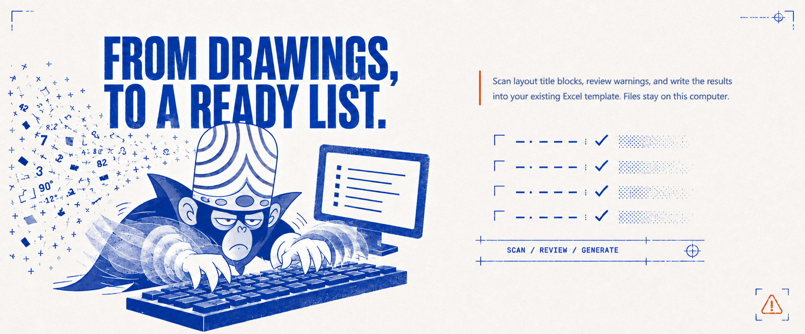
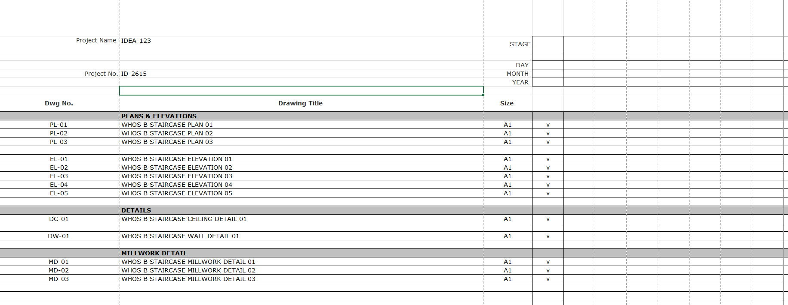
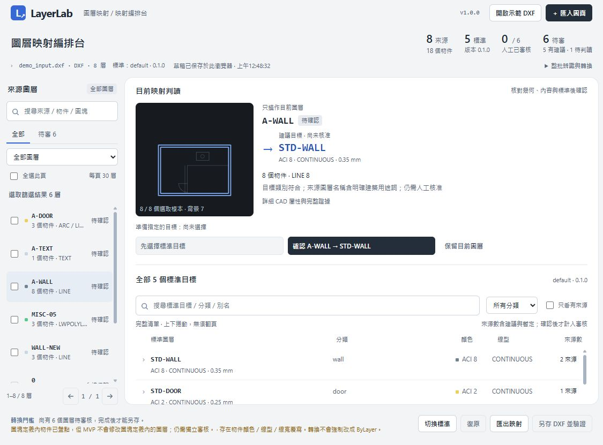

# whos-dwg

**Technical Designer | Design Technology × CAD Automation**

Turning architectural drafting challenges into practical, verifiable automation tools.

從建築與室內設計現場的製圖問題出發，開發 CAD 自動化工具，探索 AI 輔助設計，並重視人工審核、資料來源與結果驗證。

[主打專案](#featured-work) · [CAD 工具](#cad-utilities) · [研發中](#in-development) · [技術方向](#technical-focus)

## Featured Work

### [Drawing List Generator](https://github.com/whos-dwg/drawing-list-generator)

**批次讀取 AutoCAD 圖框，產生沿用既有 Excel 範本的圖紙清單。**

Read layout title blocks, review drawing data, and generate a drawing list in an existing Excel template.

**Configurable Mapping → Data Validation → Excel Generation**

先前操作展示的實際 Excel 輸出，非本次重新執行結果；點擊查看完整欄位。 / Actual output from an earlier demonstration; click for full size.

**v8.13 · Windows · AutoCAD + desktop Excel**

[Repository](https://github.com/whos-dwg/drawing-list-generator) · [Download](https://github.com/whos-dwg/drawing-list-generator/releases/tag/v8.13) · [Workflow & setup](https://github.com/whos-dwg/drawing-list-generator/blob/main/docs/USAGE.zh-TW.md) · [Compatibility](https://github.com/whos-dwg/drawing-list-generator#系統需求)

### [LayerLab](https://github.com/whos-dwg/LayerLab)

**以內容證據、人工決策與重開驗證，整理 DWG／DXF 圖層。**

Review layer content, approve mappings, and save a verified drawing copy against a defined CAD standard.

示範 DXF 的實際工作台截圖，拍攝於前一版，用於呈現基礎審核流程。 / Earlier-version workbench screenshot using the included synthetic DXF.

`Inspect content` → `Review & approve mappings` → `Save a copy` → `Reopen & validate`

從文字、圖塊與幾何證據判讀圖層，人工確認後另存並重開驗證；實測範圍與可選 DWS 匯出見專案文件。

**Preview · AutoCAD 2026 / DXF**

[Repository](https://github.com/whos-dwg/LayerLab) · [Download](https://github.com/whos-dwg/LayerLab/releases/tag/v1.0.0-preview.4) · [User guide](https://github.com/whos-dwg/LayerLab/blob/main/src/dwg-layer-standardizer/README.zh-TW.md) · [Validation scope](https://github.com/whos-dwg/LayerLab/blob/main/docs/VALIDATION.md)

## CAD Utilities

### [CadLISP Collection](https://github.com/whos-dwg/CadLISP-Index)

22 independent AutoLISP tools and 25 public commands for everyday drafting tasks.

**22 個獨立工具、25 個公開指令**，涵蓋尺寸註解、幾何處理、配置圖層、屬性編號與匯入詳圖。各工具分開維護，可依需求下載及載入。

| 工具 | 用途 |
| --- | --- |
| [LayerDirector](https://github.com/whos-dwg/CadLISP-LayerDirector) | 依命令自動分層 |
| [EQNUM](https://github.com/whos-dwg/CadLISP-EQNUM) | 尺寸等分文字 |
| [LOFTLINES](https://github.com/whos-dwg/CadLISP-LOFTLINES) | 兩曲線間插值 |

實機回歸尚待完成；部分工具有已知原碼問題，使用前請查看[驗證狀態與已知問題](https://github.com/whos-dwg/CadLISP-Index)。 / AutoCAD regression testing is pending; check each tool’s known issues.

## In Development

Exploring reviewed sketch-to-DWG and CAD-to-SketchUp workflows. These projects remain in development.

| Project | 探索方向 / Focus | Stage |
| --- | --- | --- |
| [Sketch-to-CAD](https://github.com/whos-dwg/sketch-to-cad) | 手稿判讀、人工確認與分層 DWG / Reviewed sketch-to-DWG | [Alpha](https://github.com/whos-dwg/sketch-to-cad/releases/tag/v0.1.0-alpha.5) |
| [DWG → SKP White Model](https://github.com/whos-dwg/dwg-skp-white-model) | 來源圖層白模與差異同步 / Source-layered models and CAD-driven updates | [Pre-release](https://github.com/whos-dwg/dwg-skp-white-model/releases/tag/v0.2.1) |

目前皆有來源、環境與驗證範圍限制，尚不代表可通用於任意手稿或建築圖面；詳見各專案 README。

## From Practice to Automation

My approach: make assumptions visible, keep decisions reviewable, and check the resulting files.

設計現場的資料常常不完整，規則也未必一致。我希望工具能減少重複操作，同時讓使用者看得懂它依據什麼做判斷。

- **Review before writing — 先確認，再修改。** 需要判斷的分類、映射與幾何先呈現給使用者，確認後才寫入結果。
- **Preserve the source — 保留來源。** 優先以副本與版本處理，保留圖面、資料來源與決策依據。
- **Validate the result — 核對產物。** 命令完成後，依工作範圍檢查輸出內容，必要時以原生軟體重開驗證。

These are development principles; each repository documents the checks it currently implements.

## Technical Focus

Tools and integrations used across these projects:

- **CAD automation** — AutoCAD、AutoLISP、AutoCAD .NET。
- **Local tools & integration** — Python、JavaScript／Node.js、PowerShell、Excel。
- **Geometry & modeling** — DWG／DXF 解析、Shapely、ezdxf、SketchUp C API／Ruby 橋接。
- **AI-assisted workflows** — Codex Skills、本機 CLI 橋接、人工確認與可追溯的修改流程。

## Connect

- [GitHub · whos-dwg](https://github.com/whos-dwg) — 開源工具與專案開發 / Open-source tools and development.
- [Autosad · Threads](https://www.threads.com/@autosad.tutorial) — 教學與製圖工作交流 / Tutorials and drafting workflow discussions.

歡迎交流 CAD 自動化、製圖工作流程與工具開發；工具問題也可在對應儲存庫的 Issues 提出。

For tool feedback, please open an issue in the relevant repository.
